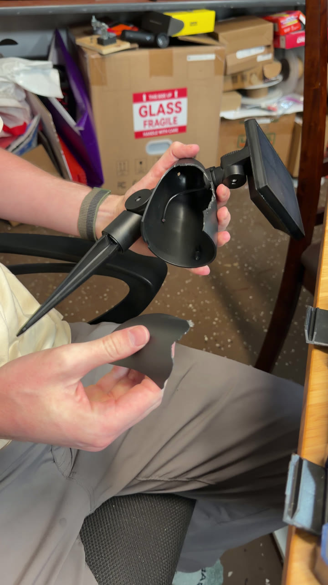
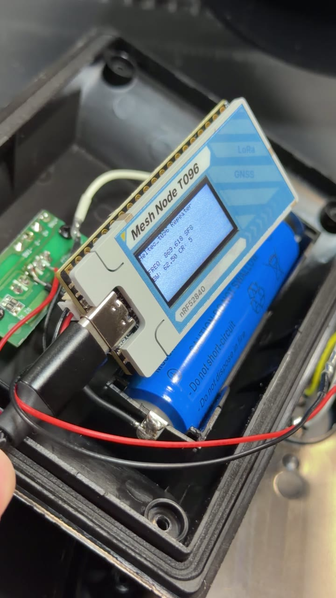
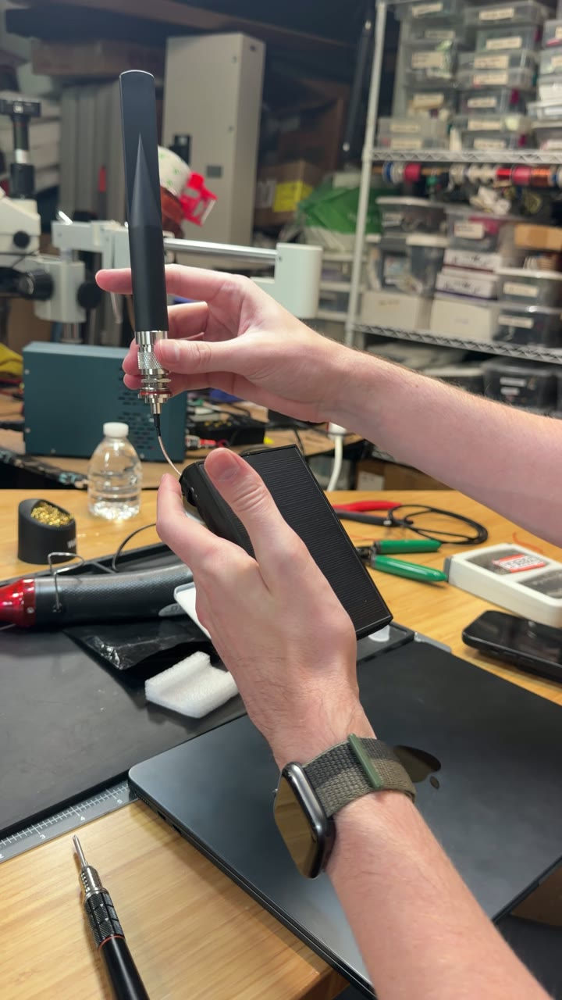
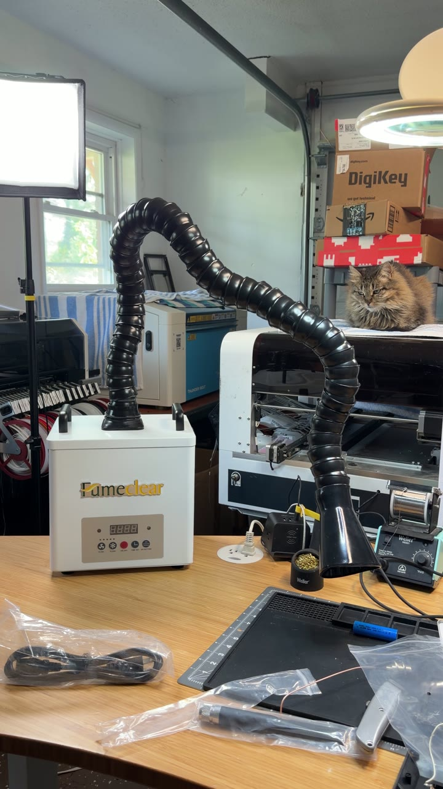
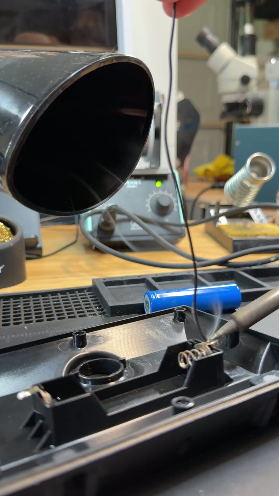
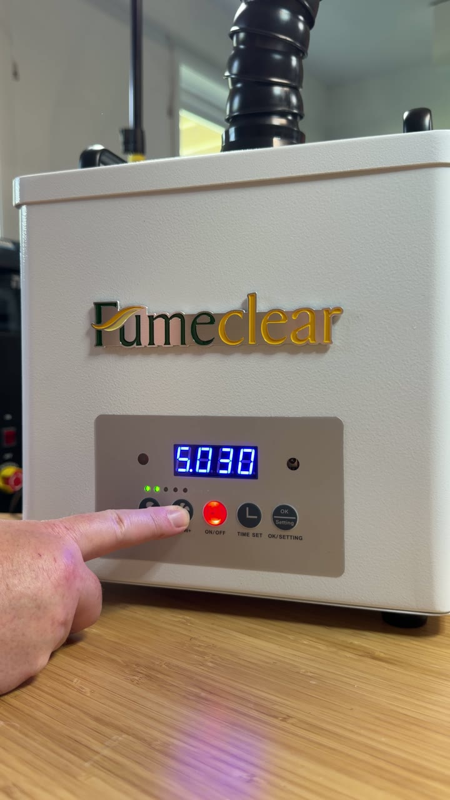
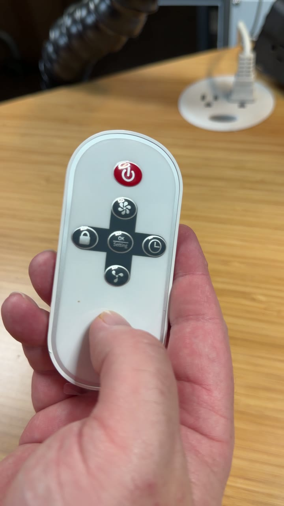

# Solar garden light to MeshCore repeater

Turn an off-the-shelf solar flood light into a solar-powered, weather-sealed radio repeater for off-grid text messaging.

The light already has what a repeater needs: a solar panel, a battery bay, a power switch and a sealed enclosure. We removed the lamp electronics we didn't need, wired in a Heltec T096 MeshNode, flashed it with MeshCore repeater firmware, and added an outdoor antenna.

  
  
  

**Watch the build:** <!-- TODO: add links after publishing -->
[Instagram Reel](TODO) · [YouTube Short](TODO)

**Build it yourself:** [step-by-step build guide](BUILD_GUIDE.md)

---

## What it does

- **Relays text messages over LoRa radio** with no cell service and no internet.
- **Runs from the sun.** The light's own panel charges the battery, and the battery runs the radio.
- **Lives outdoors.** Everything sits inside the light's original sealed housing.

[MeshCore](https://meshcore.io) is mesh-radio firmware, similar in purpose to Meshtastic, built around a network of fixed long-distance repeaters. This build is one of those repeaters.

---

## Parts

| Part | What we used | Link |
|---|---|---|
| Enclosure, solar panel, battery bay, switch | Harbor Breeze 120-lumen color-changing solar LED flood light | [Lowe's](https://www.lowes.com/pd/Harbor-Breeze-Harbor-Breeze-120-Lumen-Black-Color-Changing-Solar-LED-Flood-Light/5016087229) |
| Radio | Heltec T096 MeshNode development kit | [Amazon](https://link.amazon/B0aSpqS76) |
| Antenna | Omnidirectional LoRa antenna | [Amazon](https://link.amazon/B0ek383I5) |
| Mount | "The People's Repeater" 3D printed mount | [Printables](https://www.printables.com/model/1768397-the-peoples-repeater-affordable-solar-mesh-repeate) |
| Battery | Included with the solar light | |

Credit for the idea and the printed mount goes to the designer of The People's Repeater on Printables. <!-- TODO: add the designer's name -->

## Tools

| Tool | Notes | Link |
|---|---|---|
| Soldering iron and solder | | |
| Fume extractor | FumeClear FC-100A, the model with the digital display and remote | [FumeClear](https://tidd.ly/4AJWLlf) (affiliate link) |
| Small screwdriver set | For the enclosure screws | |
| Wire cutters and strippers | | |
| Heat shrink tubing | Slide it on before you solder | |
| USB-C cable and a computer | For flashing; use Chrome or another browser that supports Web Serial | |
| 3D printer | For the mount | |

---

## Disclosure

FumeClear sent us the FC-100A fume extractor at no cost to try. The FumeClear link above is an affiliate link, which means we earn a small commission if you buy through it, at no extra cost to you. Nobody at FumeClear reviewed this page or the video before publishing, and the opinions are ours.

<!-- TODO: if the Amazon links are Amazon Associates links, add: "As an Amazon Associate I earn from qualifying purchases." and mark them as affiliate links in the table. -->

---

## About the fume extractor

We used the FumeClear FC-100A for all the soldering in this build.

  
  
  
  

- **Three filter stages:** pre-filter, medium filter and activated carbon.
- **Five fan speeds,** shown on a digital display.
- **Remote control,** so the unit can sit on the floor or off to the side and still be switched from the bench.
- **Flexible hose with a hood.** It works best with the hood within about 15 cm (6 inches) of the joint.

<!-- TODO: one honest sentence in your own words: what you liked and one downside (on the day you said it takes up a lot of desk space, which is why the remote matters). -->

---

## Status

<!-- TODO: update once the repeater is mounted outside: location type, how it performs, battery life through a cloudy week, range. -->
Built and flashed. Outdoor mounting and range testing are next.

## Questions and improvements

Open an issue on this repository, or leave a comment on the video.

## License

<!-- TODO: choose a license for this write-up and the photos, for example CC BY 4.0. The 3D printed mount has its own license on Printables. -->
